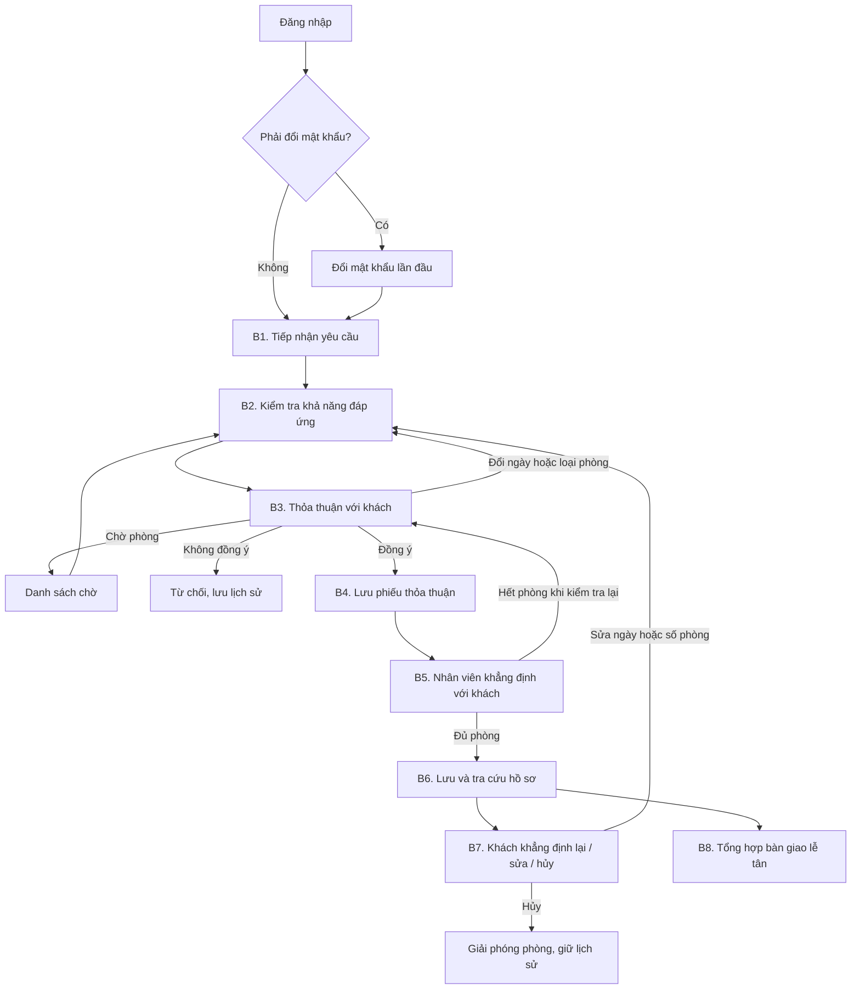
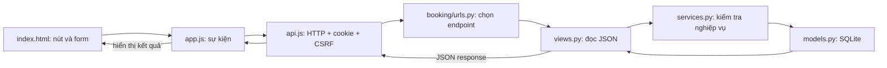
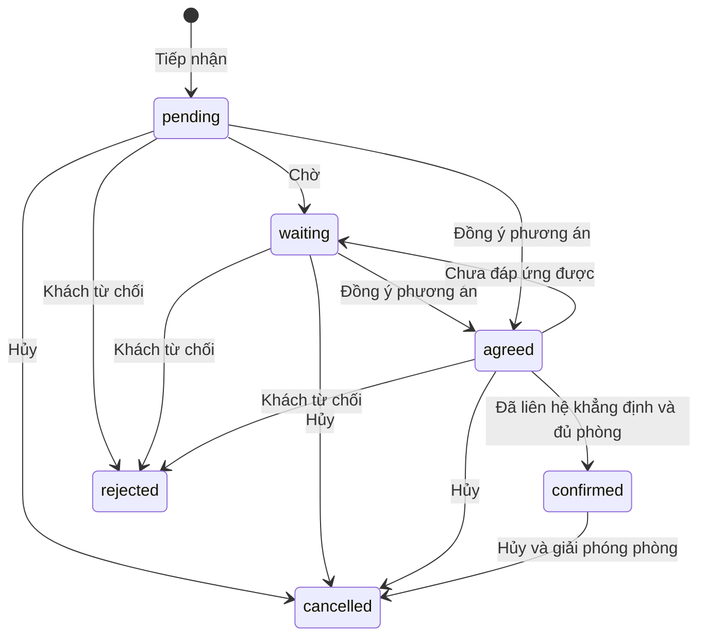

# Bản demo quy trình đặt phòng: sơ đồ và cách đọc code

Mục tiêu là một ví dụ chạy được để học cách Frontend và Backend phối hợp. Luồng
dựa trên 8 bước trong [PDF](reference/quy-trinh-dat-phong.pdf). Đăng nhập là bước
chuẩn bị, không phải bước 1 của nghiệp vụ trong PDF.

## Sơ đồ tổng thể

Yêu cầu được lưu sớm từ B1 để không mất thông tin. Khi khách đồng ý, B4 cập nhật
thành phiếu thỏa thuận. B6 là tra cứu phiếu đã được lưu xuyên suốt, không phải tạo
thêm bản sao của cùng phiếu.

## Frontend kết nối Backend như thế nào?

Ví dụ bấm “Khách đồng ý”: `app.js` gửi `action=agree`, `urls.py` chọn view
`booking_action`, view gọi `process_booking`, service kiểm tra trạng thái và lưu
phiếu cùng lịch sử. Response trả về phiếu mới để giao diện vẽ lại.

## Dữ liệu tối thiểu

- `RoomType`: tên loại phòng, tổng số phòng bán được, sức chứa và giá gốc.
- `Booking`: khách, liên hệ, kỳ lưu trú, một loại phòng, số lượng, giá thỏa thuận,
  đảm bảo, thanh toán, yêu cầu đặc biệt và trạng thái.
- `BookingEvent`: lịch sử thao tác gồm nhân viên, nội dung và thời gian.

Chỉ `confirmed` chiếm số phòng. Đơn chờ và yêu cầu mới chưa giữ phòng. Backend
kiểm tra từng đêm trong khoảng từ ngày đến đến trước ngày đi. Khách A trả ngày 03,
khách B nhận ngày 03 thì không xung đột. Khi sửa một phiếu confirmed, tồn phòng
được kiểm tra lại, không cộng chính phiếu đó hai lần.

## Kịch bản chạy thử

Khởi tạo và chạy theo [hướng dẫn chạy](huong_dan_chay_du_an.md).

1. Đăng nhập `demo / demo123`, đổi mật khẩu lần đầu. Nếu đã đổi trước đây thì dùng
   mật khẩu mới; lệnh seed không đặt lại mật khẩu.
2. Nhập khách An, số điện thoại, ngày đến/đi, loại Tiêu chuẩn, 2 phòng, 3 khách.
3. Bấm kiểm tra phòng: ban đầu loại Tiêu chuẩn có 5 phòng.
4. Lưu yêu cầu, xem mã `DP...` và lịch sử tại “Hồ sơ đặt phòng”.
5. Bấm khách đồng ý, chọn kênh điện thoại, bấm đã liên hệ khẳng định.
6. Tạo yêu cầu khác cùng khoảng ngày, kiểm tra thấy còn 3 phòng Tiêu chuẩn.
7. Thử xác nhận yêu cầu cần nhiều hơn 3 phòng: Backend trả 409, không ghi vượt tồn.
8. Đưa yêu cầu thứ hai vào danh sách chờ hoặc sửa số phòng rồi xử lý lại.
9. Mở phiếu đầu, bấm khách khẳng định lại. Thử sửa hoặc hủy kèm người yêu cầu/lý do.
10. Mở bàn giao, chọn ngày đến để thấy danh sách khách dự kiến đến. Chọn ngày đi
    để thấy danh sách khách dự kiến đi. Phiếu hủy không nằm trong danh sách này.

## Phạm vi giản lược

- Một phiếu chỉ có một loại phòng; không quản lý số phòng cụ thể hay phòng bảo trì.
  `total_rooms` là số phòng bán được do quản trị viên cấu hình.
- Có đảm bảo và phương thức thanh toán chỉ là thông tin, chưa xử lý thu tiền,
  tiền cọc, phí hủy hay tự giải phóng phiếu không đảm bảo lúc 18 giờ.
- B5 chỉ ghi nhận nhân viên đã liên hệ; không tự gửi email hoặc gọi điện.
- Chưa có role nghiệp vụ. Mọi nhân viên đã đổi mật khẩu có thể thao tác cùng dữ liệu.
- B8 là tổng hợp dự kiến, chưa quản lý no-show, ở thêm, đi sớm hay nhận/trả phòng thực tế.
- Chưa có overbooking, allotment, free sale, blacklist hoặc tích hợp bên ngoài.
- Dùng transaction và tuần tự hóa cập nhật loại phòng cho demo SQLite. Chưa kiểm
  chứng tải đồng thời lớn; có thể gặp lỗi database locked khi nhiều người ghi cùng lúc.

Các phần trên là bước nâng cấp sau khi hiểu luồng hiện tại; không coi demo là bản
triển khai đầy đủ mọi chính sách vận hành khách sạn.
